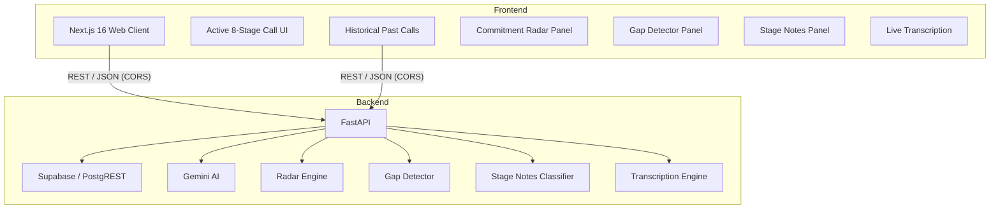

# CallFlow — AI-Powered Cold Call Assistant

### LIVE URL : https://callflow-gamma-opal.vercel.app/

> **Stay on track. Make every call count.**

CallFlow is an editorial-style, real-time web application built for B2B sales development representatives and account executives. It guides callers through a high-velocity 8-stage cold-call workflow with single-click outcome logging, prominent verbatim prospect note capture, early exit capability from any stage, structured call history search, Google Gemini AI summarization, commitment radar, conversation gap detection, prospect management, and follow-up tracking.

---

## 1. Architecture Overview

CallFlow is architected with a decoupled frontend and backend:

- **Frontend**: Next.js 16 (App Router), React 19, TypeScript, Tailwind CSS v4. Designed with an editorial navy (`#070d1e`), slate-card, and vivid electric-blue (`#0062ff`) palette. Real-time active call state is kept in memory with debounced auto-save to backend and resilient local storage recovery across browser reloads.
- **Backend**: FastAPI (Python 3.13), Pydantic v2 validation models, Uvicorn ASGI server, structured logging, and automated test suite.
- **Persistence Layer**: Supabase/PostgreSQL storage through the server-side PostgREST adapter:
  - **Production**: Supabase (PostgreSQL) using the relational schema in `backend/sql/schema.sql` with UUID keys, unique constraints on `(call_id, stage_number)`, and performance indexing.
- **LLM Synthesis**: Google Gen AI SDK (`google-genai` 2.31.0) using Gemini (`gemini-2.5-flash`) for structured JSON call summarization and next action extraction. The core calling workflow remains 100% operational even when the Gemini API is unconfigured or unreachable.
- **Commitment Radar**: AI-powered analysis of call transcripts to extract candidate commitments, detect missed opportunities, and find historical comparisons from the 100-call dataset.
- **Conversation Gap Detector**: AI analysis of call dialogue to identify unresolved questions, unconfirmed agreements, unaddressed objections, and unexplored referrals.
- **Stage Notes Analysis**: AI classification of transcript segments into the 8 cold-call stages with evidence-backed notes.
- **Live Transcription**: Real-time audio transcription via Gemini Live API through WebSocket.



---

## 2. The Eight-Stage Cold-Call Workflow

| # | Stage Name | Stage Purpose | Common Prospect Situations | Mutual Exclusive Outcomes |
|---|---|---|---|---|
| **1** | **Opening** | Reach the right person and introduce yourself. | Switchboard screening, busy/driving/lunch, contact has left company. | Reached intended person, Assistant answered, Prospect unavailable, Wrong contact |
| **2** | **Purpose** | Explain why you called in 1-2 repeatable sentences. | Asks what company does, asks where number was found, identifies sales call. | Asked what we do, Asked about the number, Identified it as a sales call, Purpose understood |
| **3** | **Permission** | Establish whether prospect is willing to speak now. | Requests callback, agrees but remains quiet, speaks without agreeing. | Agreed to talk, Requested callback, Asked for a message, Did not agree to proceed |
| **4** | **Their business** | Understand company and work before pitching offering. | Describes work briefly, corrects assumption, asks about caller business first. | Explained their business, Corrected our assumption, Asked about our business, No useful information |
| **5** | **Their need, in their words** | Discover goals, struggles, and operational bottlenecks. | Mentions goal/problem, claims no need, asks what caller can offer. (*Prominent Verbatim Field*) | Identified a need, No current need, Asked what we can offer, Need unclear |
| **6** | **Objection** | Understand reason for hesitation/refusal before countering. | Has agency/internal team, refers to other decision-maker, asks for info in writing. | Existing provider, Wrong decision-maker, Requested written information, Other objection |
| **7** | **Next step** | Agree on one concrete next action with time, date, or channel. | WhatsApp/Email report, callback scheduled, meeting agreed. | Document requested, Callback scheduled, Meeting agreed, No next step |
| **8** | **Close** | Record outcome, next step, and prospect's words from stage 5. | Follow-up agreed, not interested, referred to another person. | Follow-up agreed, Not interested, Referred to another person, Call ended unexpectedly |

> **Key Rule**: The caller can end the call early at **any stage** (Stages 1 through 7) without penalty, reflecting real sales dynamics where >55% of cold calls exit before Stage 8.

---

## 3. Project Structure

```
callflow/
├── backend/
│   ├── app/
│   │   ├── config.py           # Pydantic Settings & environment variables
│   │   ├── db.py               # Supabase/PostgREST database adapter
│   │   ├── llm.py              # Google Gen AI Gemini summary engine
│   │   ├── models.py           # Pydantic request/response schemas
│   │   ├── routes.py           # FastAPI router for all endpoints
│   │   ├── stages_data.py      # Eight cold-call stages definition & options
│   │   ├── radar.py            # Commitment radar analysis engine
│   │   ├── gap_detector.py     # Conversation gap detection engine
│   │   ├── stage_suggester.py  # AI stage suggestion from transcript
│   │   ├── gemini_pool.py      # Gemini API key pooling / failover
│   │   ├── transcription.py    # Audio transcription (file & live WebSocket)
│   │   ├── historical_radar.py # Historical call matching
│   │   ├── stage_notes.py      # Stage notes analysis from transcript
│   │   ├── routes/
│   │   │   ├── commitments.py  # Commitment CRUD endpoints
│   │   │   ├── gaps.py         # Conversation gap endpoints
│   │   │   ├── prospects.py    # Prospect management endpoints
│   │   │   ├── followups.py    # Follow-up management endpoints
│   │   │   └── stage_notes.py  # Stage notes analysis endpoint
│   ├── sql/
│   │   └── schema.sql          # PostgreSQL / Supabase relational schema
│   ├── cold-call-transcripts-100/ # 100 real cold-call transcripts dataset
│   ├── tests/
│   │   ├── test_api.py         # API endpoint tests
│   │   ├── test_supabase_operations.py  # Supabase database operations tests
│   │   ├── test_transcription.py   # Transcription tests
│   │   ├── test_radar.py           # Commitment radar tests
│   │   ├── test_gap_detector.py    # Gap detector tests
│   │   ├── test_prospects.py       # Prospect management tests
│   │   ├── test_gemini_pool.py     # Gemini key pooling tests
│   │   ├── test_live_transcription.py  # Live transcription WebSocket tests
│   │   └── test_delete_endpoints.py # Call/deletion endpoint tests
│   ├── .env.example            # Backend env documentation
│   ├── main.py                 # FastAPI application entrypoint & CORS
│   ├── requirements.txt        # Pinned Python dependencies
│   └── scripts/
│       └── verify_supabase.py  # Supabase connection verification script
├── docs/
│   └── transcript-findings.md  # Rigorous auditable analysis of 100 transcripts
│   └── demo.md                 # Demo configuration and setup
├── frontend/
│   ├── public/                 # Static assets
│   ├── src/
│   │   ├── app/
│   │   │   ├── globals.css     # Tailwind v4 styles & theme variables
│   │   │   ├── layout.tsx      # Root HTML layout & fonts
│   │   │   └── page.tsx        # Main application controller
│   │   ├── components/
│   │   │   ├── CallDetailModal.tsx   # Past call inspection & AI summary
│   │   │   ├── CurrentStagePanel.tsx # Active stage guide & controls
│   │   │   ├── EndCallModal.tsx      # Early exit & completion modal
│   │   │   ├── Header.tsx            # App bar, live call indicator & nav
│   │   │   ├── OutcomeButtons.tsx    # 4 mutually exclusive stage outcomes
│   │   │   ├── PastCallsList.tsx     # Historical calls table with filters
│   │   │   ├── ProspectNotesField.tsx# Verbatim exact-words text area
│   │   │   ├── StageProgress.tsx     # 8-stage stepper indicator
│   │   │   ├── StartCallPanel.tsx    # Prospect setup form
│   │   │   ├── CommitmentRadar.tsx   # Commitment analysis panel
│   │   │   ├── GapDetector.tsx       # Gap detection panel
│   │   │   └── StageNotesPanel.tsx   # Stage notes classification
│   │   ├── lib/
│   │   │   └── api.ts          # Strongly typed client for FastAPI
│   │   └── types/
│   │       └── index.ts        # TypeScript data interfaces
│   ├── .env.example            # Frontend env documentation
│   ├── next.config.ts          # Next.js configuration
│   ├── package.json            # Node dependencies
│   └── tsconfig.json           # TypeScript configuration
├── render.yaml                 # Infrastructure-as-code for Render deployment
└── README.md                   # Project documentation
```

---

## 4. Local Setup & Quickstart

### Prerequisites
- Node.js 18+ (tested on Node v22)
- Python 3.10+ (tested on Python 3.13)
- npm or pnpm

### 1. Backend Setup

```bash
cd backend

# Create virtual environment if not already present
python3 -m venv .venv
source .venv/bin/activate

# Install dependencies
pip install -r requirements.txt

# Configure environment variables
cp .env.example .env
# Edit .env with your optional GEMINI_API_KEY or SUPABASE credentials

# Run database tests
python -m unittest tests/test_api.py -v

# Start FastAPI backend server on port 8000
python -m uvicorn main:app --host 127.0.0.1 --port 8000 --reload
```

The backend starts at `http://127.0.0.1:8000`. Test health:

```bash
curl http://127.0.0.1:8000/health
```

### 2. Frontend Setup

In a new terminal window:

```bash
cd frontend

# Install dependencies (if needed)
npm install

# Copy example environment
cp .env.example .env.local

# Run production build or development server
npm run dev
# or
npm run build && npm run start
```

Open `http://localhost:3000` in your web browser.

---

## 5. Environment Variables

### Backend (`backend/.env`)

| Variable | Required | Default | Description |
|---|---|---|---|
| `PORT` | No | `8000` | Port for the uvicorn HTTP server |
| `FRONTEND_ORIGIN` | No | `http://localhost:3000,http://127.0.0.1:3000` | Comma-separated allowed origins for CORS |
| `GEMINI_API_KEY` | No | `""` | Google Gemini API key (server-side only, never shared with client) |
| `GEMINI_API_KEY_2` | No | `""` | Optional backup Gemini key, used automatically when the primary key hits its quota |
| `SUPABASE_URL` | No | `""` | Supabase project URL (e.g. `https://your-project.supabase.co`) |
| `SUPABASE_SECRET_KEY` | No | `""` | Supabase backend secret key (preferred, server-side only) |
| `SUPABASE_SERVICE_ROLE_KEY` | No | `""` | Alternative Supabase service role secret key |

### Frontend (`frontend/.env.local`)

| Variable | Required | Default | Description |
|---|---|---|---|
| `NEXT_PUBLIC_API_BASE_URL` | No | `http://localhost:8000` | Public backend endpoint URL |

---

## 6. Database Schema Setup

### Supabase / PostgreSQL (Production)

Run the migration script located at `backend/sql/schema.sql` directly inside the **Supabase Dashboard > SQL Editor**:

The schema creates:

- `calls`: Stores call records, status (`in_progress`, `completed`), current and highest stages (1–8), final outcome, next action, follow-up timing, and JSONB AI summaries.
- `call_stage_results`: Stores stage number (1–8), mutually exclusive outcome, verbatim prospect exact words (especially prominent in Stage 5), and notes.
- `call_commitments`: Commitment Radar extracted commitments with action, responsible party, due dates, evidence quotes, and status.
- `call_missed_opportunities`: Commitment Radar missed opportunity tracking with type, severity, evidence, and suggested actions.
- `call_conversation_gaps`: Conversation Gap Detector findings with type, severity, title, description, evidence, context, and suggested actions.
- Unique constraint `uq_call_stage UNIQUE (call_id, stage_number)` ensuring revisiting a stage updates rather than duplicates records.
- Performance indexes on `started_at`, `company_name`, `status`, `final_outcome`, `highest_stage`, and `(call_id, stage_number)`.
- Row Level Security (RLS) policies allowing full server-side backend operations.

#### Verifying Live Supabase Connection

After executing the SQL migration in Supabase, run the verification script:

```bash
./backend/.venv/bin/python backend/scripts/verify_supabase.py
```

This script validates table presence, tests call creation, stage outcome logging, verbatim note capture, stage revisit updates, call history retrieval, call completion, and cleanup.

---

## 7. API Reference

### Health & Stages

- `GET /health`: Service status, active database mode (`supabase` or `unconfigured`), and Gemini configuration status.
- `GET /stages`: Returns all 8 cold-call stage specifications, purpose, common responses, and outcome buttons.

### Calls

- `POST /calls`: Create a new call session.
  - Body: `{"company_name": "Acme Inc", "contact_name": "Jane", "phone_number": "+1...", "context": "Inbound"}`
- `GET /calls`: List saved calls. Supports query parameters `?search=...`, `?outcome=...`, `?stage=...`, `?status=...`.
- `GET /calls/{call_id}`: Retrieve a call record with all captured stage results.
- `PUT /calls/{call_id}/stages/{stage_number}`: Upsert stage outcome, verbatim words, and notes. Validates stage 1-8.
- `POST /calls/{call_id}/advance?stage_number={n}`: Advance active call stage.
- `POST /calls/{call_id}/close`: Conclude call and record final outcome, next action, follow-up timing, and channel.
- `POST /calls/{call_id}/summary`: Generate AI call summary and suggested next steps using Google Gemini.

### Commitment Radar

- `POST /calls/{call_id}/radar/analyze`: Analyze conversation dialogue to extract candidate commitments, detect missed opportunities, and find historical comparisons. Idempotent: repeated analysis updates details without duplicating records.
- `GET /calls/{call_id}/radar`: Retrieve current extracted commitments and potential missed opportunities for a call.
- `POST /calls/{call_id}/commitments`: Manually add a confirmed or tracked commitment to a call.
- `PATCH /calls/{call_id}/commitments/{commitment_id}`: Update a commitment status (confirm, edit, complete, dismiss).
- `DELETE /calls/{call_id}/commitments/{commitment_id}`: Delete a commitment record.

### Conversation Gap Detector

- `POST /calls/{call_id}/gaps/analyze`: Analyze call dialogue to detect potential missed discovery opportunities, unresolved questions, unconfirmed agreements, unaddressed objections, and unexplored referrals. Idempotent.
- `GET /calls/{call_id}/gaps`: Retrieve existing conversation gap findings for a call. Runs initial analysis if transcript exists and no findings yet.
- `PATCH /calls/{call_id}/gaps/{gap_id}`: Update finding status (open, resolved, dismissed) or details.
- `POST /calls/{call_id}/gaps/{gap_id}/create-followup`: Create a concrete follow-up commitment from a conversation gap finding, linking the commitment to the finding and marking the gap as resolved.
- `DELETE /calls/{call_id}/gaps/{gap_id}`: Delete a conversation gap finding.

### Prospects

- `GET /prospects`: Retrieve list of all available prospects populated from transcripts and added prospects.
- `POST /prospects`: Create a new prospect and save to database. Rejects duplicate company names.
- `GET /prospects/{prospect_id}`: Retrieve details for a single prospect.
- `GET /prospects/{prospect_id}/calls`: Retrieve all historical calls associated with a given prospect.
- `DELETE /prospects/{prospect_id}`: Delete a prospect from the directory.

### Follow-ups

- `GET /followups`: List all follow-up actions and commitments across all calls with prospect information.
- `PATCH /followups/{followup_id}`: Update follow-up status (e.g. mark completed, reschedule).
- `DELETE /followups/{followup_id}`: Delete a follow-up item.

### Live Transcription WebSocket

- `WS /calls/{call_id}/transcribe-live`: Real-time audio transcription via Gemini Live API.
  - Protocol: JSON messages with `{"audio": "<base64>"}` or `{"control": "stop"}`
  - Responses: `{"type": "connected" | "interim" | "final" | "error" | "done"}`
  - Persists accumulated transcript to database when session ends.

### Stage Notes Analysis

- `POST /calls/{call_id}/analyze-stage-notes`: Classify transcript segments into the 8 cold-call stages and generate concise, evidence-backed notes for each stage. Never invents statements, distinguishes explicit agreements from vague expressions, preserves exact prospect wording.

---

## 8. Transcript Analysis Findings

The workspace contains 100 cold-call transcripts (`T001.txt` to `T100.txt`). An auditable analysis was performed using Python and documented in `docs/transcript-findings.md`.

Key Findings:

1. **Median call duration is 93.5 seconds** (mean: 135.6s), proving callers need rapid, single-click outcome logging rather than lengthy manual input.
2. **13% of legacy calls had no outcome logged at all** (`not_logged`), and 0% captured verbatim quotes.
3. **Over 55% of cold calls terminate early** (18% at Stage 1, 10% at Stage 2-3, 17% at Stage 6).
4. Verbatim prospect words (e.g. `T012`: chemical manufacturing job-work margin constraints) held vital product intelligence that legacy categorical tags obliterated.

---

## 9. Deployment Instructions

### Backend on Render

1. Push this repository to GitHub.
2. In Render, select **New > Web Service** and connect the repository (or use the included `render.yaml` blueprint).
3. Configuration:
   - **Runtime**: Python 3
   - **Build Command**: `pip install -r backend/requirements.txt`
   - **Start Command**: `uvicorn backend.main:app --host 0.0.0.0 --port $PORT`
   - **Health Check Path**: `/health`
4. Set Environment Variables:
   - `GEMINI_API_KEY`: Your Google Gen AI key.
   - `GEMINI_API_KEY_2`: Optional backup key for automatic quota failover.
   - `SUPABASE_URL`: Your Supabase URL (`https://your-project.supabase.co`).
   - `SUPABASE_SECRET_KEY`: Your Supabase backend secret key.
   - `FRONTEND_ORIGIN`: Your deployed Vercel frontend URL.

### Frontend on Vercel

1. In Vercel, click **Add New Project** and select the repository.
2. Set **Root Directory** to `frontend`.
3. Set Environment Variable:
   - `NEXT_PUBLIC_API_BASE_URL`: `https://your-render-service.onrender.com`
4. Deploy.

### Production URLs

- **Frontend (Vercel)**: `https://callflow-app.vercel.app`
- **Backend (Render)**: `https://callflow-api.onrender.com`

---

## 10. Automated Tests

Run the full backend test suite:

```bash
# Run API endpoint tests:
./backend/.venv/bin/python -m unittest backend/tests/test_api.py -v

# Run Supabase database operations tests:
./backend/.venv/bin/python -m unittest backend/tests/test_supabase_operations.py -v

# Run transcription tests:
./backend/.venv/bin/python -m unittest backend/tests/test_transcription.py -v

# Run commitment radar tests:
./backend/.venv/bin/python -m unittest backend/tests/test_radar.py -v

# Run gap detector tests:
./backend/.venv/bin/python -m unittest backend/tests/test_gap_detector.py -v

# Run prospect management tests:
./backend/.venv/bin/python -m unittest backend/tests/test_prospects.py -v

# Run Gemini pool tests:
./backend/.venv/bin/python -m unittest backend/tests/test_gemini_pool.py -v

# Run live transcription WebSocket tests:
./backend/.venv/bin/python -m unittest backend/tests/test_live_transcription.py -v

# Run delete endpoints tests:
./backend/.venv/bin/python -m unittest backend/tests/test_delete_endpoints.py -v

# Run live end-to-end Supabase verification (once SQL migration is applied):
./backend/.venv/bin/python backend/scripts/verify_supabase.py
```

The test suites verify:

- Service health check
- Exact 8-stage sequence and metadata
- Call session creation and validation
- Upserting stage results without duplicating records
- Preservation of verbatim Stage 5 quotes and notes
- Early call termination from any stage
- Full call conclusion with follow-up timing
- Call history search and filtering
- Boundary validation (rejecting invalid stages 0 and 9)
- Graceful Gemini summary fallback when unconfigured
- Supabase create call, update stage, load history, and close call workflows
- Commitment radar analysis and persistence
- Missed opportunity detection and tracking
- Conversation gap detection and resolution
- Prospect creation, listing, and deletion
- Follow-up management across calls
- Live transcription WebSocket connectivity and persistence
- Stage notes analysis classification
- Stage suggestion provides evidence without mutating stage
- Non-linear flow: skipping, revisiting, manual jumping

---

## 11. Transcript Preprocessing

The 100 cold-call transcripts in `backend/cold-call-transcripts-100/` have been preprocessed and analyzed. The preprocessing script is available at `backend/scripts/preprocess_transcripts.py`. The analyzed findings are documented in `docs/transcript-findings.md` and include stage classification, identified needs, objections, and commitments extracted from the real-world call data.

---

## 12. Stage Data Definition

The eight cold-call stages are defined in `backend/app/stages_data.py` with the following properties for each stage:

- `stage_number`: Integer 1-8
- `name`: Display name (e.g., "Opening", "Purpose")
- `title`: Short title for UI
- `purpose`: Description of stage purpose
- `common_responses`: List of 4 mutually exclusive outcome options
- `outcome_options`: List of 4 possible outcomes
- `next_stage_name`: Name of the next stage (where applicable)
- `has_exact_words_prominent`: Whether this stage prominently features verbatim prospect words (Stage 5)
- `common_responses_detail`: Detailed list of common prospect situational responses

---

## 13. Gemini AI Key Pooling

The backend supports dual Gemini API key configuration via `GEMINI_API_KEY` and `GEMINI_API_KEY_2`. When the primary key hits its quota/rate limit, the system automatically fails over to the backup key. This ensures continuous AI summarization and transcription capability without manual intervention. Key pooling status can be checked via the `/health` endpoint (`gemini_configured` field).

The model pool is quota-aware. A short-lived 429/503 is cooled down using the
API-provided retry delay when available. A daily quota error disables only the
affected API-key/model pair for the current quota day, allowing another key to
try the same model. That pair is eligible again after Gemini's midnight-Pacific
reset. Gemini does not expose a remaining-request count through the normal API,
so availability is inferred from observed API responses rather than guessed by
repeatedly calling exhausted models.

Live sessions use the tested Gemini Live model family. Structured JSON and
post-call analysis remain on the unary Gemini text pool because Live models do
not support text-only responses or structured outputs. The unary pool uses
the three tested Live models first, with `gemini-3.5-flash-lite` and
`gemini-3.1-flash-lite` as fallbacks. The existing text/JSON call sites use a
compatibility adapter that returns Live output transcription and discards
generated audio. The existing transcription path and model are unchanged.
